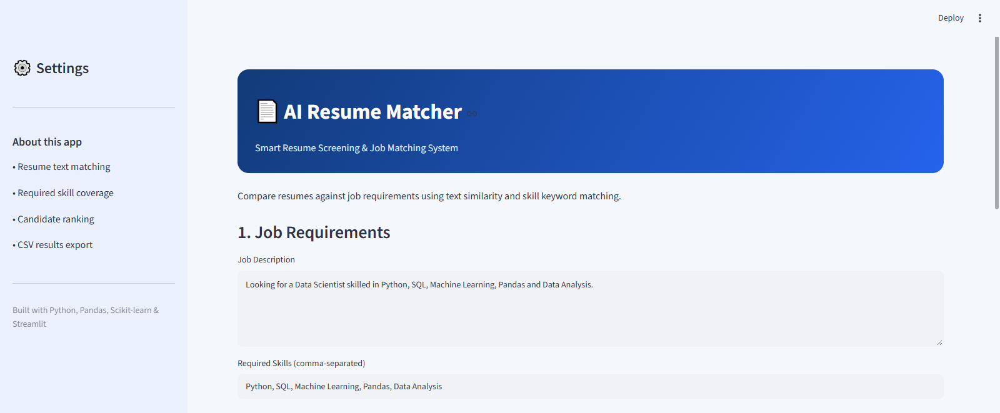
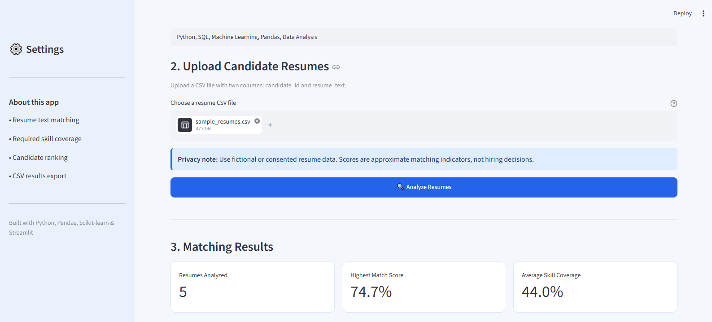
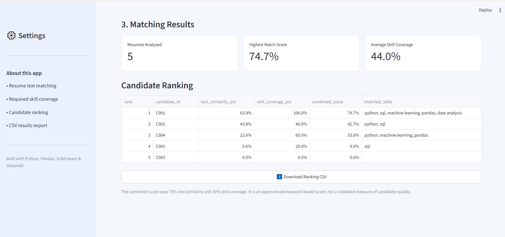
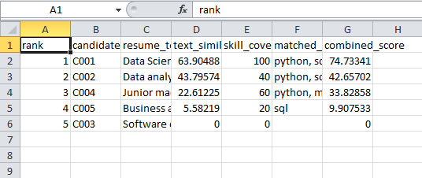
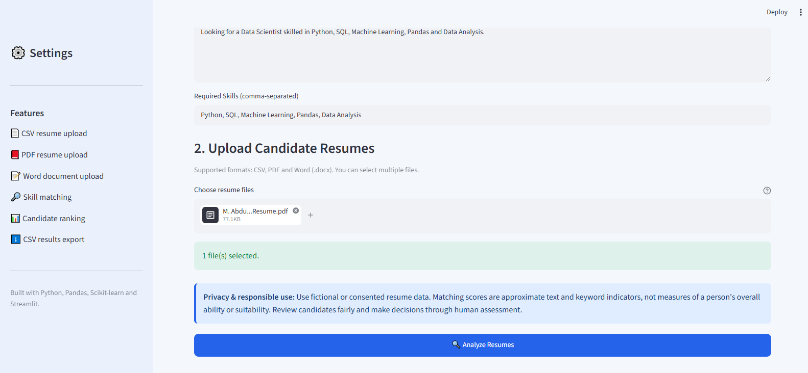
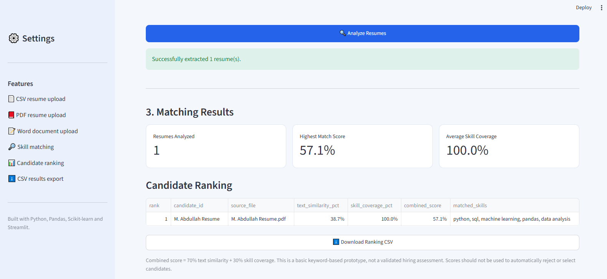

# AI Resume Screening & Job Matching System

An interactive, Python-based application that compares resumes with a job description and ranks candidates according to text similarity and required-skill coverage. Built with Streamlit and Scikit-learn.

## Project Overview

The **AI Resume Screening & Job Matching System** helps demonstrate how Natural Language Processing (NLP) techniques can support an initial resume-matching workflow.

Users can upload resumes in CSV, PDF, and DOCX formats, enter a job description, specify required skills, and view a ranked list of candidates.

This project is designed for learning and portfolio demonstration. It is not a validated hiring assessment tool.

## Key Features

- **Multiple File Formats:** Upload CSV, PDF, and DOCX resumes.
- **Job Description Matching:** Compare resume content against a target job description.
- **TF-IDF Similarity:** Use TF-IDF vectorization and cosine similarity to estimate textual relevance.
- **Skill Coverage Analysis:** Identify required skills found in each resume.
- **Candidate Ranking:** Combine text similarity and skill coverage into a matching score.
- **Interactive Dashboard:** Analyze results through a Streamlit interface.
- **CSV Export:** Download the candidate ranking report.
- **Input Validation:** Handle missing fields, empty resume text, and file-reading errors.

## Technologies Used

| Technology | Purpose |
|---|---|
| Python | Application development |
| Streamlit | Interactive web interface |
| Pandas | Data processing |
| Scikit-learn | TF-IDF and cosine similarity |
| PyPDF | PDF text extraction |
| python-docx | Word document text extraction |
| Regular Expressions | Required-skill matching |

## How It Works

1. Upload one or more resume files.
2. Enter the job description for the role.
3. Enter the required skills, such as Python, SQL, Machine Learning, Pandas, and Data Analysis.
4. Extract resume text from supported files.
5. Calculate text similarity using TF-IDF and cosine similarity.
6. Calculate skill coverage based on the required skills.
7. Combine both measures into a matching score.
8. View the ranked candidates and download the results as a CSV file.

### Matching Score

The current application uses the following weighted formula:

**Combined Score = (70% × Text Similarity) + (30% × Skill Coverage)**

These weights are configurable design choices for this demonstration, not scientifically validated hiring criteria.

## Installation and Setup

### Prerequisites

- Python 3.10 or a compatible version
- Visual Studio Code or another Python editor
- pip package installer

### 1. Clone the Repository

```bash
git clone https://github.com/MuhammadAbdullahIkram/AI-Resume-Screening-Job-Matching.git
```

### 2. Open the Project Folder

```bash
cd AI-Resume-Screening-Job-Matching
```

### 3. Create a Virtual Environment

**Windows:**

```bash
python -m venv .venv
```

Activate it:

```bash
.venv\Scripts\activate
```

### 4. Install Dependencies

```bash
pip install -r requirements.txt
```

### 5. Run the Application

```bash
streamlit run app.py
```

The application will open in your default browser. If it does not, open the local URL displayed in the terminal.

## Project Structure

```text
AI-Resume-Screening-Job-Matching/
│
├── app.py
├── requirements.txt
├── README.md
├── .gitignore
└── screenshots/
    ├── sample1.PNG to sample6.PNG
```

## Input Formats

| Format | Supported |
|---|---|
| CSV | Yes — requires `candidate_id` and `resume_text` columns |
| PDF | Yes — PDFs containing selectable text |
| DOCX | Yes — modern Microsoft Word documents |
| Scanned PDF | Not supported unless OCR is added |
| DOC | Legacy Word format is not currently supported |

## Limitations and Responsible Use

- Text similarity does not establish a candidate's true suitability for a role.
- Skill matching is based on text patterns and may miss synonyms or context.
- Results depend on the resume content, job description, required skills, and selected weights.
- The current matching score has not been validated against real recruitment outcomes.
- Use fictional or anonymized resumes for testing and protect personal information.
- Do not use the score alone to make hiring, rejection, or other consequential decisions. Human review is essential.
- Synthetic demonstration data, if used, should not be presented as evidence of real-world hiring performance.

## Future Improvements

- Add OCR support for scanned resumes.
- Improve skill extraction with NLP and synonym matching.
- Add filters for skills and job roles.
- Add resume preview and matched/missing skill details.
- Improve evaluation using an appropriately designed, representative dataset.
- Deploy the application online.
- Assess privacy, bias, and reliability before any real-world use.

## Author

**Muhammad Abdullah**  
Data Science Graduate | AI & Machine Learning

- **GitHub:** [MuhammadAbdullahIkram](https://github.com/MuhammadAbdullahIkram)
- **LinkedIn:** [Muhammad Abdullah](https://www.linkedin.com/in/muhammad-abdullah-394288242/)

## License

This project is available for educational and portfolio purposes. Add a `LICENSE` file if you choose to publish it under a specific open-source license.

---

## 📸 Application Screenshots

### Screenshot 1




### Screenshot 2



### Screenshot 3



### Screenshot 4



### Screenshot 5



### Screenshot 6




